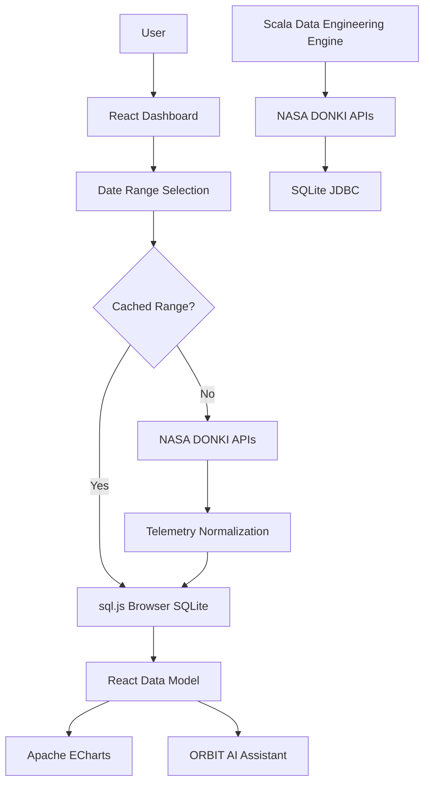

# 🛰️ SpaceGuard — NASA DONKI Telemetry & Space Weather Intelligence

> **A space weather intelligence platform that transforms NASA DONKI telemetry into interactive visual analytics, event relationships, hazard insights, and AI-assisted exploration.**

[](https://vitejs.dev/)
[](https://react.dev/)
[](https://www.scala-lang.org/)
[](https://ccmc.gsfc.nasa.gov/tools/DONKI/)
[](https://echarts.apache.org/)
[](#license)

---

## 🌌 Overview

**SpaceGuard** is a space weather monitoring and telemetry intelligence platform built around NASA's **DONKI (Database Of Notifications, Knowledge, Information)** ecosystem.

The platform retrieves telemetry from **9 NASA DONKI data feeds**, processes and normalizes the information, and organizes it into **8 analytical space-weather phenomena**.

Users can select a custom date range, query live space-weather data, explore telemetry categories, analyze event relationships, inspect interactive visualizations, and interact with **ORBIT**, the platform's AI-assisted space-weather companion.

SpaceGuard combines:

- 🛰️ NASA DONKI telemetry
- ⚡ Scala-based data engineering
- ⚛️ React + Vite
- 📊 Apache ECharts
- 🗄️ SQLite and sql.js
- 🤖 ORBIT AI assistant
- 🌌 Interactive galaxy-inspired interface

---

## 🚀 What SpaceGuard Does

SpaceGuard transforms raw space-weather telemetry into an interactive intelligence layer.

```text
NASA DONKI
    │
    ├── CME
    ├── Solar Flares
    ├── Geomagnetic Storms
    ├── SEP
    ├── IPS
    ├── MPC
    ├── RBE
    ├── HSS
    └── WSA-ENLIL
            │
            ▼
      Data Processing
            │
            ▼
       Normalization
            │
            ▼
      SQLite / sql.js
            │
            ▼
      React Dashboard
            │
      ┌─────┴─────┐
      │           │
    Charts       ORBIT
      │           │
      └─────┬─────┘
            ▼
       Space Weather
        Intelligence
```

---

## ✨ Key Features

### 🛰️ 9 NASA DONKI Data Feeds

| Feed | Phenomenon |
|---|---|
| CME | Coronal Mass Ejections |
| FLR | Solar Flares |
| GST | Geomagnetic Storms |
| SEP | Solar Energetic Particles |
| IPS | Interplanetary Shocks |
| MPC | Magnetopause Crossings |
| RBE | Radiation Belt Enhancements |
| HSS | High-Speed Streams |
| WSA-ENLIL | Solar Wind Propagation |

These feeds are consolidated into **8 analytical dashboard categories**.

### 📊 Interactive Telemetry Dashboard

SpaceGuard provides **15+ analytical visualizations** across multiple space-weather phenomena.

Visualizations include:

- CME speed analysis
- CME type distribution
- CME directional scatter analysis
- CME width distribution
- WSA-ENLIL arrival analysis
- Solar flare classification
- Solar flare intensity analysis
- Solar flare source-region analysis
- Geomagnetic Kp analysis
- SEP instrument analysis
- SEP/CME relationship analysis
- Radiation belt flux analysis
- IPS timeline analysis
- HSS analysis
- Magnetopause crossing timelines
- Multi-source event timelines

Charts are powered by **Apache ECharts**.

### 📅 Custom Date-Range Analysis

Users can define a custom analysis window directly from the dashboard.

```text
Start Date ───────────── End Date
     │                         │
     └──────────┬──────────────┘
                ▼
        NASA DONKI Query
                │
                ▼
          Data Processing
                │
                ▼
          Data Normalization
                │
                ▼
          Interactive Charts
```

The dashboard supports:

- Custom date ranges
- Cached date-range queries
- Live NASA DONKI queries
- Force-refreshing cached data
- Browser-side telemetry storage

---

## 🤖 ORBIT — SpaceGuard's AI Companion

**ORBIT** is SpaceGuard's integrated AI assistant for exploring telemetry data.

ORBIT uses the OpenRouter ecosystem and supports the `openrouter/free` model together with fallback models.

### Example Queries

```text
"Which was the fastest CME?"

"How many geomagnetic storms were recorded?"

"Show me Earth-directed CME arrivals."

"What is the best visualization for this dataset?"

"How many events are currently stored?"
```

ORBIT is designed to provide context-aware responses based on the SpaceGuard telemetry dataset.

### ORBIT Architecture

```text
                    ORBIT
                      │
             ┌────────┴────────┐
             │                 │
       OpenRouter          Local Engine
             │                 │
      openrouter/free      DB-aware logic
             │                 │
       Fallback Models          │
             └────────┬─────────┘
                      ▼
              SpaceGuard Data
```

If the external AI service is unavailable, SpaceGuard provides a **local fallback response engine** for common telemetry queries.

---

## 🧠 Data Engineering

The Scala engine provides the data-engineering component of SpaceGuard.

It performs parallel NASA telemetry retrieval using Scala `Future` operations and processes multiple telemetry feeds concurrently.

```text
                    Scala Engine
                         │
              ┌──────────┼──────────┐
              │          │          │
             CME        FLR        GST
              │          │          │
             SEP        IPS        MPC
              │          │          │
             RBE        HSS     WSA-ENLIL
              └──────────┼──────────┘
                         ▼
                  Parallel Processing
                         │
                         ▼
                    SQLite Storage
```

The Scala data-engineering layer uses:

- Scala 3.3
- Scala CLI
- uPickle 4.4.3
- SQLite JDBC 3.53
- Parallel `Future` execution
- Transactional database writes

---

## ⚙️ Data Processing Algorithms

SpaceGuard implements multiple data-processing techniques.

| # | Algorithm | Purpose |
|---|---|---|
| 1 | Fan-Out / Fan-In Parallel Processing | Parallel telemetry retrieval |
| 2 | Linear Scan + Fallback | Coordinate and location resolution |
| 3 | Tuple-Rank Sort | Ranking telemetry events |
| 4 | Fold / Max | Maximum Kp and intensity calculations |
| 5 | GroupBy Statistics | Distribution and daily aggregation |
| 6 | Transactional Batch Processing | Multi-table database insertion |
| 7 | Hash Binning + Set Union | Event grouping and relationship analysis |
| 8 | Hash Map + Mask Filter | Fast event filtering |

---

## 🗄️ Database Architecture

SpaceGuard uses two complementary SQLite implementations.

### Scala Engine

The Scala engine uses SQLite JDBC:

```text
Scala Engine
     │
     ▼
SQLite JDBC
     │
     ▼
database/spaceguard.db
```

The database stores telemetry from the nine DONKI feeds along with supporting query data.

### Browser Dashboard

The React dashboard uses **sql.js**, which provides SQLite functionality through WebAssembly.

```text
React
  │
  ▼
sql.js
  │
  ▼
SQLite WASM
  │
  ▼
Browser Memory
```

This allows the dashboard to perform database-style operations directly inside the browser without requiring a traditional application backend.

The browser-side database also maintains a **query cache** for previously requested date ranges.

---

## 🏗️ System Architecture

SpaceGuard intentionally separates the Scala data-engineering engine from the React dashboard.

The Scala engine and React application are **sibling processes rather than a client/server pair**.



### Runtime Relationship

```text
Scala Data Engineering Engine
            │
            ├── NASA DONKI
            ├── Data Processing
            └── SQLite JDBC

React Dashboard
            │
            ├── NASA DONKI
            ├── sql.js
            ├── Apache ECharts
            └── ORBIT
```

The Scala JAR is a **CLI data-engineering engine**, not an HTTP backend.

---

## 🎨 User Interface

SpaceGuard uses a space-inspired visual system designed around a deep-space environment.

The interface includes:

- 🌌 Animated galaxy background
- 🎨 Multiple visual themes
- 📊 Multiple chart palettes
- 📡 Interactive telemetry cards
- 📈 Interactive ECharts visualizations
- 🛰️ Space-weather themed navigation
- 🤖 Integrated ORBIT assistant
- ⚙️ Persistent user preferences

### Themes & Customization

SpaceGuard provides:

- **7 visual themes**
- **6 chart palettes**
- Persistent `sg_prefs` configuration

Users can customize the visual appearance of the dashboard without modifying the underlying data or processing system.

---

## 🧩 Technology Stack

| Layer | Technologies |
|---|---|
| Frontend | React 18, Vite 5 |
| Styling | Tailwind CSS |
| Visualization | Apache ECharts 5 |
| Data Engineering | Scala 3.3 |
| Scala Runtime | Scala CLI |
| Serialization | uPickle 4.4.3 |
| Database | SQLite |
| Browser Database | sql.js / SQLite WASM |
| Space Weather Data | NASA DONKI |
| Additional Space Weather Context | CCMC, NOAA |
| AI | OpenRouter |
| Parallel Processing | Scala Futures |
| Deployment | Vercel |

---

## 📡 Data Sources

SpaceGuard is built primarily around NASA's DONKI ecosystem.

### Primary Source

**NASA DONKI**

DONKI provides structured information about multiple space-weather events and phenomena.

### Additional Sources & Context

- NASA Goddard Space Flight Center
- NASA Community Coordinated Modeling Center
- NOAA space-weather classifications

All live telemetry queries are performed according to the selected date range.

---

## 🛠️ Installation

### Prerequisites

Make sure the following are installed:

- Node.js
- npm
- Java 21+
- Scala CLI
- Git

### Clone the Repository

```bash
git clone https://github.com/SK4LEGENDS/SpaceGuard.git
cd SpaceGuard
```

### Install Dependencies

```bash
npm install
```

---

## 🔐 Environment Variables

Create a `.env` file in the project root.

```env
VITE_NASA_API_KEY=YOUR_NASA_API_KEY
VITE_OPENROUTER_API_KEY=YOUR_OPENROUTER_API_KEY
```

You can use NASA's `DEMO_KEY` for basic testing, subject to NASA API rate limits.

> **Never commit your `.env` file to GitHub.**

The repository provides an `.env.example` file as a template.

---

## ▶️ Running SpaceGuard

### Option 1 — Start the Complete Local Environment

```bash
run.bat
```

or:

```bash
start_spaceguard.bat
```

This starts:

```text
Scala Data Engineering Engine
        +
React/Vite Dashboard
```

The dashboard runs at:

```text
http://localhost:3000
```

### Option 2 — Run React Manually

```bash
npm install
npm run dev
```

Then open:

```text
http://localhost:3000
```

---

## 🏭 Production Build

Create the production build:

```bash
npm run build
```

Preview it locally:

```bash
npm run preview
```

The production frontend is generated inside:

```text
dist/
```

---

## ☁️ Deployment

SpaceGuard's interactive dashboard is designed for **static Vite deployment**.

### Vercel Configuration

```text
Framework: Vite
Build Command: npm run build
Output Directory: dist
```

The Vercel deployment hosts the React dashboard.

The Scala JAR remains a separate data-engineering component and is **not required as a Vercel backend**.

### SPA Routing

The project uses a Vercel rewrite so that client-side routes resolve correctly.

```json
{
  "rewrites": [
    {
      "source": "/(.*)",
      "destination": "/index.html"
    }
  ]
}
```

### Deployment Architecture

```text
                    Vercel
                      │
                      ▼
              React + Vite SPA
                      │
             ┌────────┴────────┐
             │                 │
             ▼                 ▼
       NASA DONKI          sql.js WASM
             │                 │
             └────────┬────────┘
                      ▼
              Interactive Dashboard
                      │
                      ▼
                    ORBIT
```

---

## 📁 Project Structure

```text
SpaceGuard/
│
├── database/
│   └── spaceguard.db
│
├── public/
│
├── scala/
│   ├── V9.scala
│   └── spaceguard.jar
│
├── src/
│   ├── components/
│   │   ├── DashboardPage.jsx
│   │   ├── LandingPage.jsx
│   │   ├── Header.jsx
│   │   ├── ChatbotSidebar.jsx
│   │   ├── SettingsPage.jsx
│   │   └── ...
│   │
│   ├── services/
│   │   ├── donkiApi.js
│   │   └── sqliteService.js
│   │
│   ├── App.jsx
│   └── main.jsx
│
├── .env.example
├── .gitignore
├── package.json
├── package-lock.json
├── tailwind.config.js
├── vite.config.js
├── vercel.json
├── run.bat
└── start_spaceguard.bat
```

---

## 🔄 End-to-End Data Flow

```text
                    USER
                      │
                      ▼
             Select Date Range
                      │
                      ▼
              React Dashboard
                      │
                      ▼
             Check Browser Cache
                  /       \
                YES       NO
                 │         │
                 ▼         ▼
              sql.js    NASA DONKI
                 │         │
                 │         ▼
                 │    Normalize Data
                 │         │
                 └────┬────┘
                      ▼
                Telemetry Model
                      │
             ┌────────┼────────┐
             ▼        ▼        ▼
          Charts    Tables    ORBIT
             │        │        │
             └────────┴────────┘
                      ▼
               SpaceGuard UI
```

---

## 📚 Technical Documentation

The application includes an integrated technical documentation section covering:

- Space-weather theory
- NASA DONKI feeds
- Data-processing algorithms
- Database schema
- System architecture
- Visualization methodology
- Telemetry relationships
- ORBIT architecture

The documentation is available directly inside the application through the **Technical Docs** section.

---

## 🛰️ Space Weather Phenomena

SpaceGuard organizes the incoming telemetry into eight primary analytical categories:

1. **CME — Coronal Mass Ejections**
2. **Solar Flares**
3. **Geomagnetic Storms**
4. **Solar Energetic Particles**
5. **Interplanetary Shocks**
6. **Radiation Belt Enhancements**
7. **High-Speed Streams**
8. **Magnetopause Crossings / Related Solar-Wind Events**

WSA-ENLIL simulation data is additionally used to analyze solar-wind propagation and Earth-directed CME arrival scenarios.

---

## 📈 Analytical Capabilities

### CME Analysis

SpaceGuard analyzes:

- CME velocity
- CME type
- Source location
- Latitude and longitude
- Angular width
- Earth-directed events
- Estimated arrival times
- WSA-ENLIL simulation results

### Solar Flare Analysis

The dashboard analyzes:

- Flare classifications
- Flare intensity
- Peak times
- Source regions
- Temporal distributions

### Geomagnetic Storm Analysis

The system provides:

- Kp index analysis
- Storm severity distributions
- Daily storm timelines
- Multi-source comparisons

### SEP Analysis

SpaceGuard provides:

- SEP event timelines
- Instrument distributions
- CME associations
- Daily event trends

### IPS Analysis

The dashboard provides:

- IPS event timelines
- Instrument analysis
- Location analysis
- Catalog information
- HSS relationships

### Radiation Belt Analysis

The platform analyzes:

- Radiation belt enhancement events
- Flux measurements
- Temporal behavior
- Relationships with other space-weather phenomena

### HSS Analysis

High-Speed Stream analysis includes:

- Event timelines
- Instrument information
- Relationships with RBE and GST events

### MPC Analysis

Magnetopause crossing analysis includes:

- Event timelines
- Event relationships
- Multi-source comparisons

---

## 🔬 Event Relationships

One of SpaceGuard's key analytical capabilities is connecting multiple telemetry phenomena.

Examples include:

```text
CME
 │
 ├── Solar Flare
 │
 ├── SEP
 │
 ├── WSA-ENLIL Simulation
 │
 └── Geomagnetic Storm
```

and:

```text
HSS
 │
 ├── Radiation Belt Enhancement
 │
 └── Geomagnetic Storm
```

These relationships allow users to move beyond isolated event counts and explore how different space-weather phenomena are connected.

---

## 💾 Browser Caching

SpaceGuard maintains a browser-side telemetry cache using sql.js.

When a user requests a date range:

```text
User Query
    │
    ▼
Check Cache
    │
 ┌──┴──┐
 │     │
YES    NO
 │     │
 ▼     ▼
Load   NASA
Cache  DONKI
 │     │
 │     ▼
 │   Process
 │     │
 └──┬──┘
    ▼
Dashboard
```

This reduces unnecessary repeated requests for previously queried date ranges.

Users can also force a live refresh when required.

---

## 🔐 API Key Handling

SpaceGuard uses environment variables for API configuration.

```env
VITE_NASA_API_KEY=YOUR_NASA_API_KEY
VITE_OPENROUTER_API_KEY=YOUR_OPENROUTER_API_KEY
```

The `.env` file should remain local and must not be committed to the repository.

Only `.env.example` should be included in source control.

---

## 📦 NPM Scripts

The project provides the following standard scripts:

```bash
npm run dev
npm run build
npm run preview
```

### Development

```bash
npm run dev
```

### Production Build

```bash
npm run build
```

### Production Preview

```bash
npm run preview
```

---

## 🧪 Development Workflow

A typical development workflow is:

```text
1. Start development environment
        ↓
2. Open SpaceGuard dashboard
        ↓
3. Select telemetry date range
        ↓
4. Query NASA DONKI
        ↓
5. Normalize telemetry
        ↓
6. Store/query browser database
        ↓
7. Generate visualizations
        ↓
8. Explore data using ORBIT
```

---

## 👥 Team

### Kailash

M. Tech AIML (VIT Chennai)

### SriViknesh

M. Tech AIML (VIT Chennai)

---


## 📜 License

This project is released under the **MIT License**.

See [`LICENSE`](LICENSE) for details.

---

# 🛰️ SpaceGuard

> **Observe the Sun. Understand the Storm. Protect the Future.**

**SpaceGuard turns raw space-weather telemetry into intelligence.**
