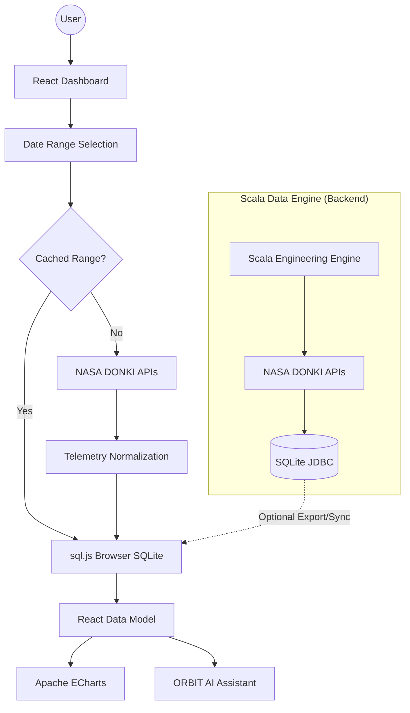

# 🌌 SpaceGuard — NASA DONKI Telemetry & Space Weather Intelligence

<p align="center">
  
  
  
  
  
  
</p>

**SpaceGuard** is a professional space weather intelligence platform that transforms raw NASA DONKI telemetry into interactive visual analytics, event relationships, hazard insights, and AI-assisted exploration.

---

## 🏗️ System Architecture

SpaceGuard intentionally separates the **Scala data-engineering engine** from the **React dashboard**. Unlike traditional client-server apps, these are sibling processes designed for maximum data throughput and zero-latency UI.

### 📉 Technical Flowchart


---

## 🛠️ Core Systems Deep-Dive

### 🛰️ How DONKI Integration Works
The system integrates 9 distinct NASA feeds, mapping them into **8 Space Weather Phenomena**. 
- **The Process**: The Scala Engine performs a parallel "Fan-Out" fetch $\rightarrow$ applies **Temporal Chunking** (splitting large ranges to avoid HTTP 400) $\rightarrow$ normalizes raw JSON into a strictly typed relational model.
- **Phenomena Mapped**: 
  - **CME & WSA-ENLIL**: Tracking plasma ejections and shock arrival.
  - **Solar Flares**: Logarithmic intensity ranking (A $\rightarrow$ X class).
  - **Geomagnetic Storms**: Kp-index reduction to derive NOAA G-Scale threats.
  - **SEP, IPS, MPC, RBE, HSS**: High-energy particle and wind stream telemetry.

### 🤖 The ORBIT Reasoning Engine
ORBIT is not a simple chatbot; it is a **Hybrid Intelligence Layer** that follows a deterministic pipeline:

1. **Classification**: Every query is scored against an 11-intent taxonomy (e.g., `viz`, `dataQuery`, `briefing`).
2. **Deterministic Execution**: If the intent is `dataQuery` (e.g., "Fastest CME?"), ORBIT executes a real SQL-like filter on the telemetry. **0 API calls, 100% accuracy**.
3. **Contextual Augmentation**: For complex questions, ORBIT builds a **Compact Fact Block** (summarizing current trends and anomalies) and injects it into an LLM via OpenRouter.
4. **Route Visualization**: If the user asks to "see the flares," ORBIT triggers a `routeViz()` call that physically navigates the dashboard to the correct tab.

### 🚀 Mission Control (The SITREP)
**Mission Control** is the platform's high-level situational awareness hub. It provides a "SITREP" (Situation Report) by aggregating:
- **Global Threat Score**: A calculated 0-100 score based on current solar activity.
- **NOAA G-Scale**: Real-time classification of geomagnetic intensity.
- **Anomaly Detection**: Flagging "Outlier" events that deviate from the window mean.
- **Causal Chains**: Mapping the sequence: `Flare` $\rightarrow$ `CME` $\rightarrow$ `Solar Wind` $\rightarrow$ `Storm`.

---

## 🛠️ Tech Stack

| Layer | Technology | Purpose |
| :--- | :--- | :--- |
| **Backend** | Scala 3.3 / JVM | Parallel Ingestion, Data Reduction, Normalization |
| **Frontend** | React 18 / Vite 5 | Observability UI, State Orchestration |
| **Database** | SQLite / sql.js | Relational Storage (Local & WASM) |
| **Visualization**| Apache ECharts | Telemetry Plotting & Analytics |
| **Styling** | Tailwind CSS | Glassmorphic Design & Responsive Layout |
| **AI/LLM** | OpenRouter / Gemma | NLQ & Contextual Intelligence |

## 🏃 Getting Started

### Backend (Scala)
```bash
java --enable-native-access=ALL-UNNAMED -jar scala/spaceguard.jar 2026-01-01 2026-09-30
```

### Frontend (React)
```bash
npm install
npm run dev
```

---
**Developed by:** Kailash & SriViknesh  
**Project:** VIT Python & Data Systems Project
